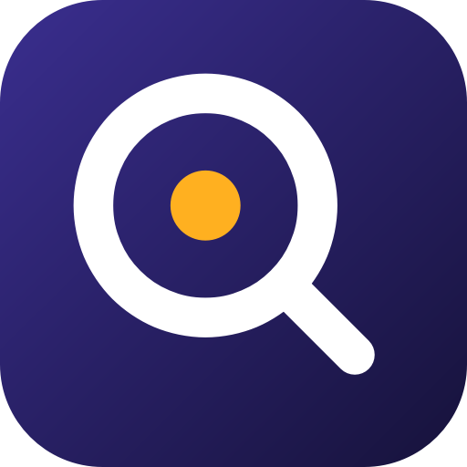
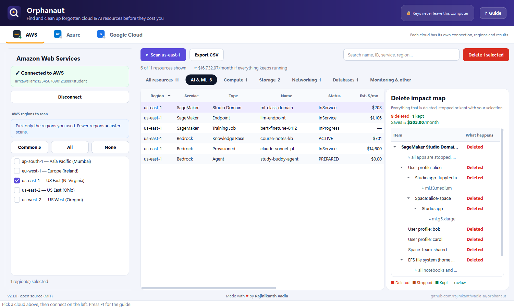

<div align="center">



# Orphanaut

### Find and delete forgotten AWS, Azure, Google Cloud **and AI** resources — before they cost you.

Free, open-source desktop app for **Windows** and **macOS**. Scan your cloud account, see what is still running and what it costs, check the **delete impact map**, and clean up safely — including **SageMaker**, **Bedrock (Claude)**, **Azure OpenAI** and **Vertex AI**.

[](https://github.com/rajinikanthvadla-ai/orphanaut/releases/latest)
[](https://github.com/rajinikanthvadla-ai/orphanaut/actions/workflows/ci.yml)
[](LICENSE)




</div>

---

## Why Orphanaut?

Cloud labs and AI experiments leave things running: a SageMaker Studio domain with a GPU app, a Bedrock knowledge base whose vector store bills ~$350/month, an Azure OpenAI provisioned deployment, a Vertex AI endpoint, a NAT gateway nobody remembers. Each console hides them in a different place.

Orphanaut puts **every billable leftover in one list**, shows a **rough monthly cost**, and before you delete anything shows a **map of everything that goes with it** — so you know that deleting a SageMaker domain also removes its user profiles, spaces, apps and home EFS volume, while your S3 data is kept.

## Features

- ☁️ **AWS, Azure and Google Cloud** — one tab per cloud at the top, each with its own connection, regions and results. Connect to all three at once.
- 🤖 **AI & ML cleanup** — SageMaker, Bedrock (including **provisioned throughput for Claude**), OpenSearch Serverless vector stores, Kendra, Comprehend, Rekognition, Azure OpenAI / AI Services / AI Foundry, Azure Machine Learning, Azure AI Search, Vertex AI, Workbench, Agent Engine and Vertex AI Search.
- 🗺️ **Delete impact map** — select any resource to see what is **deleted**, **stopped** or **kept** with it. The same map is shown again in the confirmation dialog.
- 🔗 **Cascade deletion in the right order** — e.g. Studio apps → spaces → user profiles → domain + EFS; knowledge base data sources → knowledge base → vector store; Azure ML compute → endpoints → workspace → its storage / key vault / registry; Vertex endpoints are undeployed first.
- 🔑 **Three ways to sign in on every cloud**
  - **Keys** — AWS access keys, Azure service principal, Google service account JSON
  - **Sign in with browser** — AWS IAM Identity Center (SSO, no CLI needed), Microsoft account, Google account
  - **This computer** — reuses `aws configure` / `aws sso login`, `az login`, `gcloud auth application-default login` (auto-detected)
- 🗂️ **Category tabs** — All · AI & ML · Compute · Storage · Networking · Databases · Monitoring
- 💸 **Cost estimates** per resource and in total, so you clean up the expensive things first
- 🔒 **Safe by design** — keys stay in memory only, in-use or committed resources are locked, nothing is deleted without an explicit confirmation
- 📤 **CSV export** including the linked items of each resource
- 📘 **Built-in guide** (press **F1**) with where-to-find-your-keys steps and required permissions

## Download — no Python needed

Get the latest version from **[Releases](https://github.com/rajinikanthvadla-ai/orphanaut/releases/latest)**:

| Your computer | Download | How to run |
|---|---|---|
| **Windows 10/11** | `Orphanaut-Setup-Windows.exe` | Run the installer (no admin needed) → Start menu → **Orphanaut** |
| Windows (portable) | `Orphanaut-Windows-Portable.zip` | Extract to e.g. `C:\Orphanaut` → `Orphanaut.exe` |
| **Mac with Apple Silicon** (M1–M4) | `Orphanaut-macOS-AppleSilicon.dmg` | Open → drag **Orphanaut** to Applications |
| Mac with Intel | `Orphanaut-macOS-Intel.dmg` | Open → drag **Orphanaut** to Applications |

> **Windows SmartScreen:** click **More info → Run anyway** (the app is not code-signed yet).
> **macOS Gatekeeper:** right-click Orphanaut → **Open → Open**. If macOS says the app is damaged, run `xattr -dr com.apple.quarantine /Applications/Orphanaut.app`.

## Quick start (2 minutes)

1. Open Orphanaut and pick **AWS**, **Azure** or **Google Cloud** at the top.
2. On the left choose how to connect — **Access keys**, **Sign in with browser**, or **This computer** — and connect.
3. Tick the regions you used (start with one) and press **Scan**.
4. Open the **AI & ML** tab (or any category). Click a row to see its **delete impact map**.
5. Select what you don't need → **Delete selected** → review the map → confirm.

## What gets found

| Cloud | AI & ML | Everything else |
|---|---|---|
| **AWS** | SageMaker Studio domains (profiles, spaces, apps, EFS), running Studio apps, endpoints (+ configs, models, inference components), notebook instances, training / processing / tuning / transform jobs, MLflow tracking servers, HyperPod clusters, feature groups · Bedrock knowledge bases (+ data sources + OpenSearch Serverless vector store), agents, provisioned throughput, custom & imported models, fine-tuning and batch jobs · OpenSearch Serverless · Kendra · Comprehend endpoints · Rekognition Custom Labels | EC2, EBS volumes & snapshots, Elastic IPs, NAT gateways, load balancers, VPC endpoints, security groups, RDS (instances & clusters), DynamoDB, ElastiCache, Lambda, ECS, EKS (+ node groups, Fargate profiles), S3, Route 53, CloudWatch Logs, Lightsail |
| **Azure** | Azure OpenAI & AI Services accounts (deployments, AI Foundry projects, PTU), Azure Machine Learning workspaces / AI Foundry hubs (compute instances & clusters, online & serverless endpoints, linked storage / key vault / App Insights / registry), Azure AI Search | Virtual machines, managed disks, public IPs, storage accounts |
| **Google Cloud** | Vertex AI endpoints (+ deployed models), models, Vector Search endpoints & indexes, custom / pipeline / tuning jobs, Agent Engine, Colab Enterprise runtimes, Feature Store online stores, Vertex AI Workbench, Vertex AI Search apps & data stores | Compute Engine instances, persistent disks, static IPs, Cloud Storage buckets |

## Permissions

| Cloud | To scan | To delete |
|---|---|---|
| AWS | `ReadOnlyAccess` managed policy | Delete rights per service — `PowerUserAccess` or `AdministratorAccess` in a lab account |
| Azure | **Reader** on the subscription | **Contributor** |
| Google Cloud | **Viewer** on the project | **Editor** (APIs that aren't enabled are skipped automatically) |

> Use a dedicated sandbox / student account. **Deletion is permanent.**

## Run from source

```bash
git clone https://github.com/rajinikanthvadla-ai/orphanaut.git
cd orphanaut
python -m venv .venv
# Windows: .venv\Scripts\activate    macOS/Linux: source .venv/bin/activate
pip install -e .
orphanaut
```

Developers: `pip install -e ".[dev]"`, then `ruff check src tests`, `pytest`, and `python -m orphanaut --self-test`.
Build the desktop app with `pyinstaller orphanaut.spec --noconfirm`. Pushing a tag like `v2.1.0` builds the Windows installer, macOS DMGs and Python wheel and publishes a GitHub release.

## Project structure

```
src/orphanaut/
├── auth/          # Sign-in for AWS (keys, SSO device flow, profiles), Azure, Google Cloud
├── scanners/      # One scanner per service — sagemaker.py, bedrock.py, azure_ai.py, gcp_vertex.py, …
├── actions/       # Deletion, including ordered cascades for AI resources
├── dependencies.py# Delete impact map model
├── categories.py  # Category tabs
├── providers/     # Sessions, pricing, small ARM / Google REST clients
└── ui/            # PySide6 desktop UI (cloud tabs, workspaces, impact map, guide)
```

## FAQ

**Is it free?** Yes — MIT licensed, no account, no telemetry.

**Does it send my keys anywhere?** No. Keys are held in memory for the session and only sent to AWS, Microsoft or Google when calling their APIs.

**Will it delete my data in S3 / Blob / Cloud Storage?** Only if you select and delete the bucket or storage account itself. AI cascades never touch your training data or model artifacts — they show as *Kept — review* in the map.

**Why is a resource locked?** It is in use (e.g. a Vertex model deployed to an endpoint, an attached disk) or under a commitment (Bedrock provisioned throughput with a term). Delete its parent first.

**Can I use it in a classroom?** That is what it was built for. Students download the installer, sign in with the keys or browser login their instructor gives them, and clean up after each lab.

## Contributing & security

Contributions are welcome — see [CONTRIBUTING.md](CONTRIBUTING.md). Report vulnerabilities as described in [SECURITY.md](SECURITY.md). **Never commit cloud credentials.**

## License

MIT — see [LICENSE](LICENSE).

---

<div align="center">

**Made with ♥ by [Rajinikanth Vadla](https://github.com/rajinikanthvadla-ai)** · If Orphanaut saved you money, please ⭐ the repo so other students can find it.

<sub>Keywords: AWS cost cleanup, delete unused AWS resources, find orphaned cloud resources, Azure cleanup tool, GCP unused resources, SageMaker cleanup, delete SageMaker domain, Bedrock knowledge base cost, Azure OpenAI cost, Vertex AI cleanup, cloud cost for students, FinOps desktop app.</sub>

</div>
